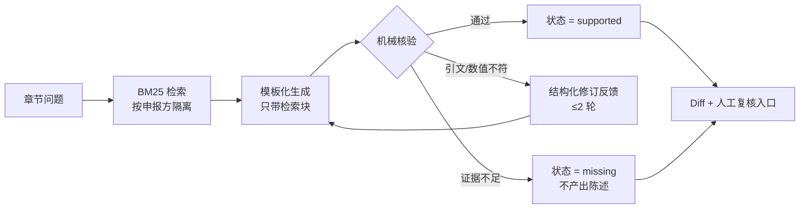
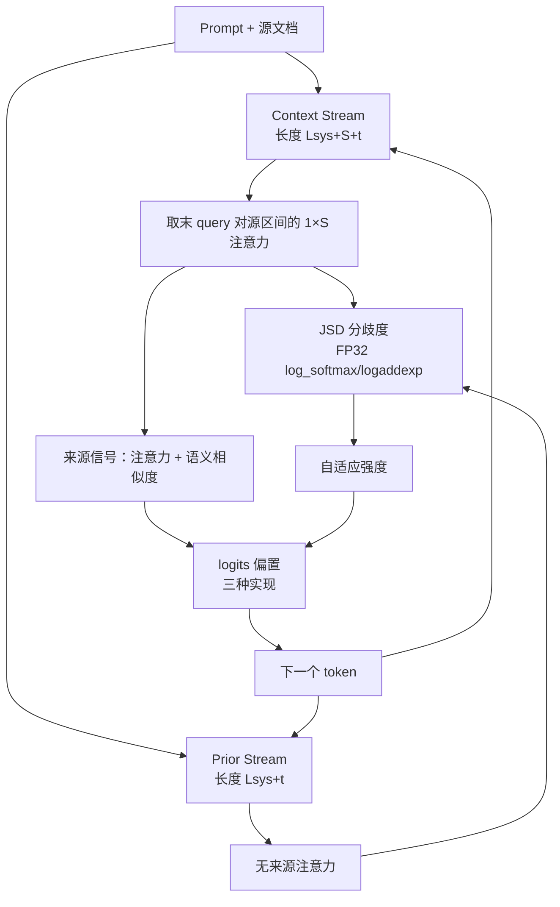
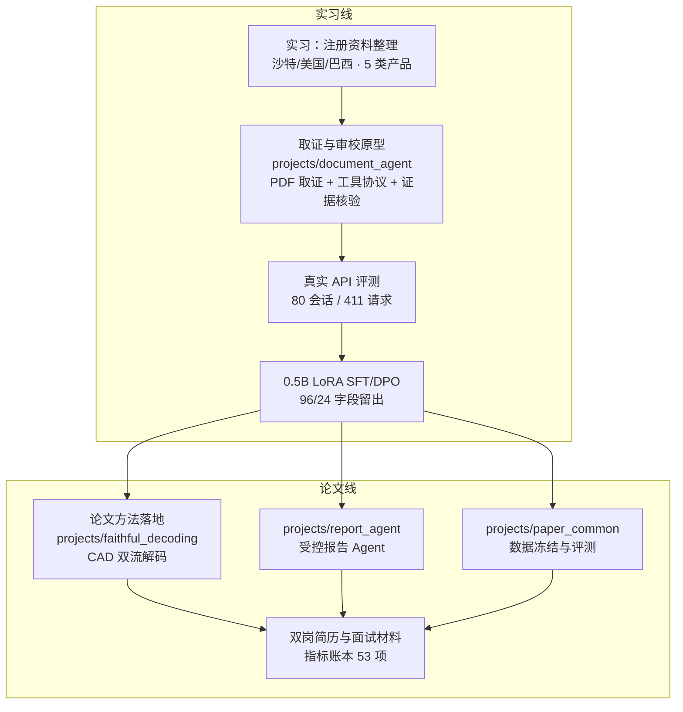

# 架构与边界

## 一、受控文档 Agent



组件与职责：

| 模块 | 职责 | 关键约束 |
|---|---|---|
| `projects/report_agent/engine.py` | 工具循环、预算、重试与章节恢复 | 逻辑调用上限 20 次；HTTP 重试与逻辑预算分开计数；按（来源、模型、配置）三元组哈希恢复 |
| `projects/report_agent/schema.py` | Pydantic 状态不变量 | `supported / missing / conflict` 三态；非法 JSON 修复至多一次 |
| `projects/report_agent/evidence.py` | 机械核验 | 引文必须是原文连续子串；观测 ID 必须来自本轮工具返回；文档归属与数值单位对齐 |
| `projects/report_agent/review.py` | 修订与差分 | 每节最多 2 轮；保留 before/after 供人工判读 |

**为什么是 BM25 而不是向量检索**：注册资料的核心查询是型号编号、条款号与带单位的物理参数，稠密向量会把不同申报方的相似句式拉到一起，产生跨来源混用；本轮没有做 embedding 对比实验，这里只陈述选型理由。

**为什么最多 2 轮**：修订轮次与成本线性相关；实测第 3 轮起新增修订与新增错误的数量相当（`revision.count_increases` 与 `count_decreases` 接近），因此把剩余问题交给人工，而不是继续烧请求。

## 二、上下文忠实解码（CAD）



| 设计点 | 做法 | 原因 |
|---|---|---|
| 来源区间注意力 | 对 `[Prefix+Source+Generated]` 的注意力在源区间内做二次 softmax | 全长 softmax 后源区间权重和远小于 1，且随生成长度漂移 |
| 余弦映射 | `(cos+1)/2` | 余弦取值范围含负值，直接加权会引入符号翻转 |
| JSD | FP32 下 `log_softmax` + `logaddexp` | 概率极小时 FP16/BF16 会下溢 |
| 去重聚合 | `unique(return_inverse)` + `scatter_add` | 位置级权重映射到词表级，避免 Python 循环 |
| 语义中心度 | 单位向量均值点积 | 与两两点积期望等价，复杂度 O(S²d) → O(Sd) |
| 双流一致性 | 同一 `y_t` 同时追加到两条分支 | 保证两套 KV Cache 的生成历史严格一致 |

单测覆盖：增量解码与全序列重算的 logits／注意力切片一致性、零偏置时与原生 greedy 逐 token 一致、`unique+scatter_add` 与直接实现的结果一致。

## 三、数据与后训练

```mermaid
flowchart LR
    PDF[3 份公开 FDA 510(k)] --> C[corpus.json<br/>375 块]
    C --> G[受控变更 140 例]
    G --> P[120 对偏好数据<br/>86 对强负例]
    P --> SFT[LoRA SFT<br/>96 对训练]
    SFT --> REF[冻结参考策略 log-probs]
    SFT --> DPO[DPO<br/>参考策略校正]
    SFT --> EV[固定黄金工具观测评测<br/>4 任务留出]
    DPO --> EV
```

| 口径 | 值 | 说明 |
|---|---|---|
| 训练／留出 | 96 对／24 对 | 按字段家族整体留出（working_length、light_source），不是按行随机 |
| 强负例 | 86 / 120 | 同一任务、同一批工具观测下，只改最终结论与引用 |
| 可训练参数 | 1,081,344 | LoRA r=8、alpha=16，q/k/v/o |
| 显存 | 峰值 allocated ≈ 1.24–1.35 GiB | 单卡 8GB；不是整卡占用 |

**边界**：训练与评测都在同一份文档、同一套模板内完成，属于同源字段留出，不能当作跨文档泛化证据；生成评测使用固定黄金工具观测，不代表自主工具调用能力。

## 四、仓库与两条线的演进



`projects/document_agent` 是两条线共用的底座，论文线没有改动它的代码，只在它之上新增了三个包；`main` 分支保留实习线与交接记录，论文分支（`codex/paper-driven-agent-algorithm`）承载两个新项目与简历材料。
