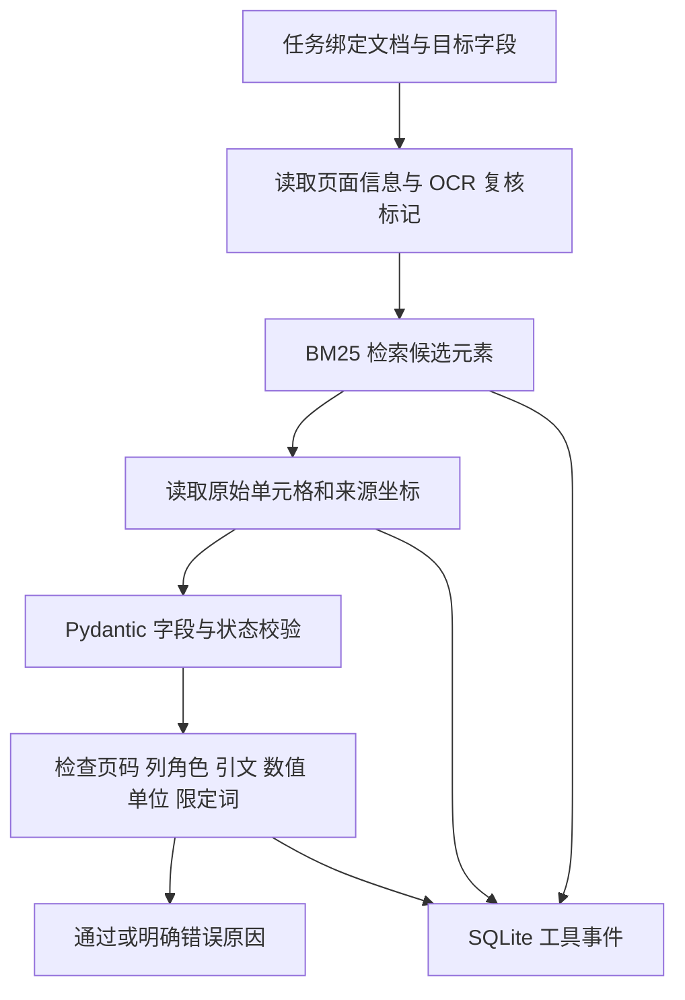
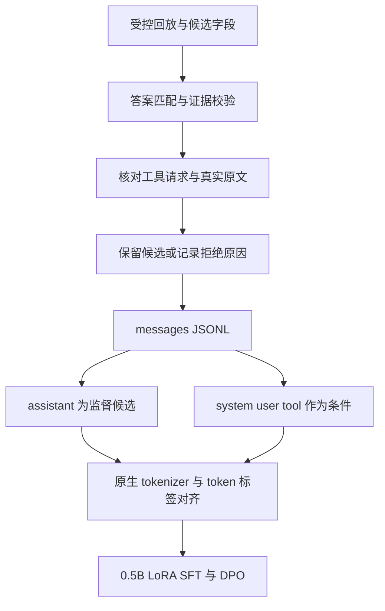

# 专业文档取证与训练数据校验原型

跨窗口当前信息见 [共享入口](../../memory/README.md)；运行环境以 [2026-11-05 实测记录](../../memory/02_运行环境.md) 为准。Windows 项目环境与 WSL 的 CUDA 环境分开记录。

已实现 PDF 文本／表格取证、结构与来源校验、Function Calling 适配、有界工具执行循环、SQLite 事件重执行、轨迹筛选与原生模板的 token 级监督编码。2026-11-06 已完成 DeepSeek／混元真实 API 评测，以及 RTX 4060 上 Qwen2.5-0.5B 的 LoRA SFT／DPO；原脚本协议测试仍保留为独立单测。

最新结果见 [真实模型实验报告](../../docs/11_真实模型评测与GPU训练.md)。第二轮同源20题开发集严格通过19/20、20/20；小模型SFT在固定证据下4个留出任务通过4/4，DPO边距扩大但生成降至0/4，当前保留SFT作为更可用检查点。API和本地训练是两条独立实验线。

## 直接运行

在当前工作区 PowerShell 中：

```powershell
& '.\projects\document_agent\run.ps1'
& '.\projects\document_agent\run.ps1' -Mode test
& '.\projects\document_agent\run.ps1' -Mode protocol
& '.\projects\document_agent\run.ps1' -Mode tokenize
& '.\projects\document_agent\run.ps1' -Mode build-resumes
& '.\projects\document_agent\run.ps1' -Mode algorithms
& '.\projects\document_agent\run.ps1' -Mode build-algorithm
```

默认使用 Conda `ai-job-search`，脚本内部执行 `conda run -n ai-job-search python ...`，不依赖系统 Python，也不需要手动激活。可通过 `-CondaEnvironment` 指定其他环境。新机器可在工作区根目录运行 `conda env create -f environment.yml` 创建同名环境。

源 PDF 已下载到 `data/public/`；重新下载可以运行 `run.ps1 -Mode download`，只访问清单中的三个公开 FDA 地址，不读取公司资料或上传用户文件。

Tokenizer 的 Transformers 和 Jinja2 已安装到该 Conda 环境。早期 `.deps/` 仅保留为旧运行时的兼容回退，Conda Python 不加载它。首次取 tokenizer 运行 `run.ps1 -Mode download-tokenizer`，只下载五个配置／分词文件，固定仓库 revision 和 SHA-256，不下载模型权重。

## 后训练算法验证

新增 `preference_data.py`、`post_training.py`、`transformer_whitebox.py` 和 `validate_algorithms.py`。PyTorch 2.9.1 已安装在同一 Conda 环境，本轮使用 CPU 小张量进行数学与梯度验证；`run.ps1 -Mode algorithms` 可复现偏好数据及算法报告。

- 导出 120 对偏好数据，其中 86 对为答案相同、证据无效的受控困难负例。chosen／rejected 共享任务、真实工具观测和 prompt，只改变模型最终字段输出，避免惩罚环境故障。
- 对格式、答案和证据分别记录规则奖励分项；权重是人为配置，不是训练出的奖励模型，也未执行 GRPO。
- 实现 Shift-by-one 交叉熵、token／sample 归约、序列 log-probs、DPO 参考策略校正和 SimPO 长度归一化／边距。
- 编码全部偏好对，公共 prompt 中的 assistant 历史动作也不参与偏好响应监督；用真实标签位置和小词表随机 logits 验证数值与梯度，不作为模型能力指标。
- PyTorch 白盒检查 RMSNorm、交错旋转形式的 RoPE、SwiGLU、GQA，以及增量 KV Cache 与全序列因果注意力的一致性。不是某个完整预训练模型的复现。
- 按参数精度、梯度、AdamW 状态和缓存配置计算显存，明确排除激活、分配器和运行时等开销。

原阶段产物：`preference_pairs.jsonl`、`hard_negative_pairs.jsonl`、`preference_tokenized.jsonl`、`rule_reward_tensors.pt`、`preference_report.json` 和 `algorithm_report.json`。该阶段测试65项；新增HTTP／评分和训练准备测试后，当前77项通过，见 `artifacts/live_test_report.json`。

硬件为 RTX 4060 Laptop GPU，8188 MiB 显存。Windows `ai-job-search` 继续负责CPU测试和API评测；WSL专用 `/home/bingyu/.venvs/ai2resu-gpu` 只读继承 `physical_ex` 的CUDA依赖，在新venv安装PEFT／PDF解析依赖，已完成真实训练。已有Conda环境未升级，完整环境见共享记录。

## 实际使用的技术

- Conda Python 3.11、pdfplumber：文本行、表格单元格、PDF 物理页码和边界坐标。
- BM25：按任务文档、元素类型和表格角色筛选后检索。
- 当前分词器为英文／数字基线；没有验证中文或多语种检索效果。
- Pydantic / JSON Schema：工具参数、字段状态、证据引用和额外字段限制。
- SQLite：记录检索、读取、校验的运行 ID 和工具事件，并可重新读取事件。
- unittest：验证数值边界、错列、伪引用、跨文档请求、观测与来源不一致等情况。
- Transformers / AutoTokenizer：使用 Qwen 原生 chat template 和 fast offsets，生成 token 级 `-100` 标签及右侧 padding 批次。
- Function Calling 适配：函数描述、`tool_calls`、`tool_call_id` 关联、参数解码、工具结果回传、执行预算和最终证据检查。

模型服务通过 provider callable 注入；`live_provider.py` 用标准库HTTP连接用户提供的本机网关，鉴权通过环境变量传入，不写日志。当前工具被限定在索引文档中，不提供宿主机 shell；这是应用层受控执行，不等同于操作系统或容器隔离。

## 公开来源

| 文档 | 页数 | 官方来源 |
|---|---:|---|
| K231105 | 10 | [FDA PDF](https://www.accessdata.fda.gov/cdrh_docs/pdf23/K231105.pdf) |
| K243708 | 7 | [FDA PDF](https://www.accessdata.fda.gov/cdrh_docs/pdf24/K243708.pdf) |
| K252598 | 6 | [FDA PDF](https://www.accessdata.fda.gov/cdrh_docs/pdf25/K252598.pdf) |

来源 URL、文件大小和 SHA-256 记录在 `data/public/sources.json`。这些是公开样例，不是实习公司的内部项目文件。字段标注来自对 K231105 PDF 第 7、8 页的人工核对；PDF 物理页码不同于文档印刷页码。

## 当前结果及边界

完整机器可读结果见 [metrics.json](artifacts/metrics.json)，简表见 [RESULTS.md](artifacts/RESULTS.md)。当前解析 3 份 PDF、23 页，建立 765 个行／表格元素，其中 99 个表格单元格；按文本稀疏度标记 5 页需要 OCR 复核。

20 条字段事实是同一文档内 10 个字段的申报／对比产品成对记录。140 条校验用例由这些事实进行受控扰动构造，包括干净样本和错值、错页、伪锚点、伪引文、错列、额外字段六种错误。它们不是 140 个独立业务任务，也不是模型生成样本。

机械检查在这组开发用例上保留 20 个干净记录、拒绝 120 个扰动记录；答案字符串匹配会保留 106 条受控回放，而加入来源、列角色和工具观测检查后保留 20 条。该差异说明当前构造场景下证据检查的作用，不是模型质量提升或真实轨迹错误比例。

BM25 在这 20 条已知字段查询中能找到对应锚点，仅作为开发冒烟测试，不当作独立测试集上的泛化成绩。

## 修掉的真实解析问题

K231105 的表格存在合并表头：标题的逻辑列号是 `c2/c5`，数值单元格却落在 `c1/c4`。直接用矩阵列序号关联表头会丢失申报／对比产品角色。

当前改为计算表头与单元格的横向坐标覆盖关系。跨多角色的宽单元格保留未知状态，不强行归类。同一数值同时出现在两列时，校验还需要检查列角色，单纯匹配数字不足以发现错列。

## 核心代码入口

- `evidence_core.py`：PDF 解析、BM25、Pydantic 数据模型、工具分派、字段与轨迹校验、SQLite 事件记录。
- `run_project.py`：人工核对字段清单、受控错误构造、工具回放、数据导出与结果记录。
- `test_evidence_core.py`、`test_tool_protocol.py`、`test_token_masking.py`：共 37 项行为测试，结果保存于 `artifacts/test_report.json`。
- `artifacts/tool_schemas.json`：可供后续模型工具调用适配的参数 Schema。
- `artifacts/demo_tool_replay.json`：确定性工具回放，明确标为非 LLM 执行。
- `artifacts/sft_messages_controlled_replay.jsonl`：原始受控回放候选数据。
- `tool_protocol.py`：Chat Completions 文本／函数工具子集的适配与有界执行循环。
- `verify_protocol.py`：20 组脚本提供者联调、来源指纹检查及实际工具重执行。
- `token_masking.py`：原生模板编码、assistant-only labels、完整轮次截断和右侧 padding。
- `artifacts/sft_messages_function_calling.jsonl`：带调用 ID、真实工具返回和工具定义的 20 条协议记录。
- `artifacts/sft_tokenized.jsonl` 与 `sft_training_batch.npz`：实际 `input_ids`、`attention_mask` 和 `labels`。
- `artifacts/tokenization_report.json` 与 `token_mask_preview.json`：分词、掩码统计和可读检查样例。

## Token 级监督验证

当前 Conda 环境中，20 条样本共编码 23,629 个非 padding token，其中 2,280 个 assistant 目标 token；其余上下文及 371 个 padding 位置置为 `-100`，批次形状为 `20 × 1200`。实际解释器和依赖版本见 `artifacts/environment_report.json`，分词统计以 `artifacts/tokenization_report.json` 为准。这里的 7B 仅指 tokenizer 所属模型，没有加载 7B 权重或进行梯度训练。

监督区间从原生模板对话前缀定位，再用 fast tokenizer 的字符 offset 对齐，避免用文本搜索误标重复内容。保留 assistant 的动作、最终回答和结束符；system／user／tool、角色前缀及 padding 不监督。超过预算时只保留完整 assistant 轮次，没有可监督完整轮次则拒绝样本。

测试包括重复文本、用户伪造 assistant 标记、中文与 emoji、多工具返回、结束符、截断和 padding。Qwen 的工具模板在 system 中也出现 `<tool_call>` 示例，测试明确区分该上下文示例与真实 assistant 调用。

## 协议与回放验证

按 [OpenAI Docs 的 Function Calling 说明](https://developers.openai.com/api/docs/guides/function-calling) 和 [Chat Completions 参考](https://developers.openai.com/api/reference/resources/chat/subresources/completions/methods/create) 实现文本／函数工具子集。provider 可返回 assistant message 或完整 `choices[0].message` 包装。

本地联调中，20 个脚本提供者会话完成工具调用、结果回传及最终证据验证；20 个工具事件重新执行后与持久化记录相符。记录以 JSON 的规范形式比较，处理 SQLite 序列化将坐标 tuple 转为 array 的差异。它验证协议与工具行为，不代表模型任务成功率。

## 工具流转



## 数据筛选与监督边界



## 下一步

增加独立标注文档与来源留出，延续真实工具基线；针对DPO边距增大却破坏JSON的现象，设计更小步长、早停或SFT约束的对照。未经验证不把开发集迭代当跨文档泛化收益。

工具来源机械一致不代表完整语义正确，更不构成注册合规或产品安全结论。
